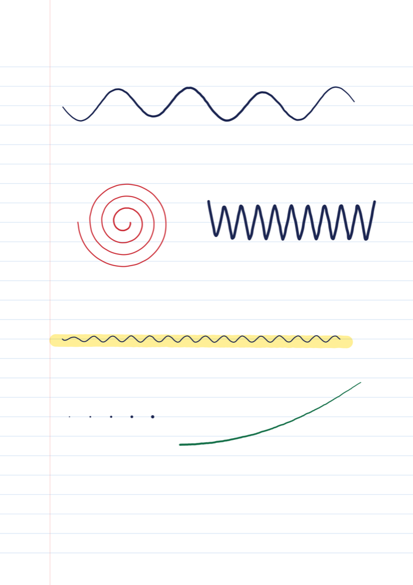

# Strokebook

[](https://github.com/IncognitoQuack/Strokebook/actions/workflows/ci.yml)


[](LICENSE)

**A fast, native macOS handwriting notebook for pen tablets.** Write, annotate PDFs and study, with ink that keeps up with your pen.

<p align="center"></p>

<p align="center"><sub>Synthetic strokes rendered by the real ink pipeline: pressure-varying line weight, smooth curves, a clean highlighter.</sub></p>

Built in Swift with AppKit and SwiftUI, with no third-party dependencies. Tuned on an XPPen Star G640, and works with any pressure-sensitive tablet (and a mouse or trackpad).

## Features

- **Smooth, low-latency ink:** every tablet sample, a 2D 1€ filter, motion prediction and pressure curves you can tune to your own hand (Pen Lab).
- **PDF annotation:** import, write on, highlight (snaps to the text), search and export PDFs with vector text and clickable links kept. A 1,000-page PDF opens in under 0.1 s.
- **Smart ink:** shape and arrow recognition, scribble to erase, convert handwriting to text, and handwritten sums that answer themselves.
- **Search everything:** handwriting (on-device Vision), typed text and PDF text, across all notebooks.
- **Study tools:** flash cards from tape with spaced repetition (SM-2), audio recording linked to your strokes with on-device transcription, a ruler and a zoom window.
- **Organised and safe:** folders, AES-256-GCM password lock, atomic saves with automatic recovery, and a library that can live in iCloud Drive, Google Drive or any folder.
- **Import from GoodNotes:** pages, templates and pen strokes from your own `.goodnotes` exports.

## Requirements

macOS 14 or later, and the Xcode Command Line Tools (`xcode-select --install`). Full Xcode is not needed.

## Build, test, run

```bash
zsh test.sh                    # core engine + storage tests (no Xcode needed)
ARCHS=arm64 zsh build.sh       # fast dev build → build/Strokebook.app
zsh build.sh                   # universal (Apple Silicon + Intel)
```

Self-test: `Strokebook.app/Contents/MacOS/Strokebook --library /tmp/lib --screenshot /tmp/shots`.
It writes, erases, lassoes, undoes and reloads through the real event handlers, then prints `ui-checks: …` and a memory reading.
Use a throwaway `--library` folder so it never touches your notebooks.

## Pen and gestures

| Input | Action |
|---|---|
| Pen tip | Current tool (pen, highlighter, eraser, lasso) |
| Lower pen button: hold + draw | Erase (one undo step) |
| Lower pen button: click | Swap between your last two tools |
| Upper pen button: hold + drag | Pan the page |
| Upper pen button: click | Undo |
| Pause at the end of a stroke | Snaps it to a line, arrow, rectangle, ellipse or triangle; a line keeps following the pen |
| Scribble back and forth over ink | Erases it (a long line you only crossed is left alone) |
| T / K | Text box / Laser pointer |
| ⌘-click (or click with the lasso) | Opens a link |
| ⇧⌘T, ⌘K | Convert selected handwriting to text, add a link to the selection |
| ⇧⌘F | Search all notes: titles, typed text and handwriting |
| ⌥⌘S, ⇧⌘B | Show/hide the page sidebar, bookmark the page |
| U / ⌘R | Study tape / Ruler |
| ⇧⌘Y, ⌥⌘R, ⇧⌘= | Study due cards, start/stop audio recording, solve selected sum |
| ⌥⌘P | Pen Lab: measure your pen and hand, apply a personal pressure curve |
| ⌥⌘Z | Zoom window: write large in the strip, ink lands small in the box; ⌥-click the page to move the box |
| Space + drag | Pan |
| Two-finger double-tap (trackpad) | Smart zoom in on that spot / back to fit |
| Shift while drawing | Straight line snapped to 15° |
| Write a sum ending in = and pause | The answer appears (Settings › Answer sums as I write) |
| Text tool: click a box / drag a box | Edit it / move it |
| Page Up/Down, Home/End, mouse back/forward | Change page |
| Esc | Cancel the current gesture, then deselect |
| ⌘? | Gestures & Shortcuts window |
| ⌘ + scroll, or pinch | Zoom around the pointer |
| P / H / E / L | Pen / Highlighter / Eraser / Lasso |
| ⌫, arrows, ⌘D, Esc | Delete / nudge / duplicate / deselect the lasso selection |

**XPPen driver setup:** lower button → *Mouse Right Click*, upper button → *Mouse Middle Click*. Map the tablet to one display with proportions kept, so circles stay round.
Settings (⌘,) has pressure feel (Soft/Natural/Firm), prediction, hold-to-straighten and pen-only mode.

## Working with PDFs

- **Bring PDFs in:** Library › Import PDF (⇧⌘O), drag PDFs onto the library, Finder › Open With › Strokebook, or drop one on the Dock icon. Inside a notebook, Insert › Image or PDF… (or drag a PDF onto the page) adds its pages after the current one.
- **Every tool works on PDF pages:** pen, highlighter, eraser, lasso, text boxes, images, tape, ruler, zoom window, audio, links.
- **Highlighter snaps to the PDF's text:** a rough swipe becomes a clean highlight exactly on the line, from word edge to word edge (Settings › Highlighter snaps to the text in PDFs). Over pictures or blank areas it stays freehand.
- **Search:** the PDF's own text is searchable, along with your handwriting and typed notes. The PDF's table of contents becomes page bookmarks.
- **Export:** File › Export Notebook as PDF keeps the original pages as sharp vector text, with your ink, highlights and clickable links on top.
- **Speed:** a 1,000-page PDF opens in under 0.1 s and scrolls smoothly; imports run in the background with progress.

## Importing from GoodNotes

In GoodNotes, export a notebook as **GoodNotes** format (`.goodnotes`). Then in Strokebook choose Library › **Import…** (⇧⌘O), drop the file on the library, or use Finder › Open With › Strokebook.
- **What comes over:** pages in order, the cover and paper templates (exactly, as vector PDFs), and every pen stroke with its colour and its thick-thin pen shape. Everything is then fully editable with Strokebook's tools.
- **What's reported:** item types not supported yet (typed text, pictures) are counted and listed after import, never dropped silently. Empty items, such as a scratch-out gesture's leftover, draw nothing in GoodNotes either and are skipped.
- **How it works:** a zip of protobuf record streams. Strokes are Apple-LZ4 "tpl" blobs holding quadratic centre-line curves of (x, y, radius) points. See `Sources/Core/GoodNotes.swift`.

## How it stays smooth

- **Every sample:** AppKit's mouse coalescing is turned off while drawing, so all of the tablet's reports arrive.
- **2D 1€ filter in screen space:** removes jitter when slow, adds no lag when fast, and feels identical at every zoom. It's 2D, not per-axis, so circles don't get squared off.
- **Curves and outlines:** centripetal Catmull-Rom densifies sparse fast strokes. The outline is the non-zero union of tapered capsules, so there are no holes or spikes on hairpin turns.
- **Live stroke on Core Animation:** finished segments freeze into chunk layers, so the cost per pen sample stays constant however long the stroke gets. A short (≤12 px) motion prediction hides input latency.
- **No flicker:** on pen-up the page redraws synchronously before the live layer is removed, in one transaction.
- **Hover nib preview:** a hardware cursor shows the nib at its exact size and colour, with zero lag.

## Storage

- **Location:** notebooks live in `~/Library/Application Support/Strokebook/Notebooks/<uuid>.inkwell` (or in the existing `Inkwell` folder there, if you used the app under its old name). The `.inkwell` extension and file format are unchanged, so old files open and new files open in older builds that support their format version.
- **File layout:** magic `INKW`, a format version, CRC32, an uncompressed metadata block for fast listing, and an LZFSE-compressed binary plist with points packed at 16 bytes each.
- **Safe saves:** writes are atomic. The previous *valid* file is kept as `.bak`, and a damaged file opens from it automatically, with a notice.
- **Newer versions:** files from a newer format version are refused, never silently downgraded.
- **Autosave:** about 0.8 s after any edit, on window close, on app switch and on quit. If a save fails, you're told and nothing in memory is dropped.
- **Deleting:** notebooks go to the Trash, so deletion can be undone in Finder.

## Layout

```
Sources/Core   Model, InkEngine, Storage, Renderer   (no AppKit; unit-tested)
Sources/App    App, Session, Canvas, LiveInk, NotebookWindow, Library, State
Tests/main.swift   ~250 checks: sanitising, filter, outline, hit-testing, precise erase, shapes, arrows, scribble,
                   links, text layout, PDF export/import, images, codec damage, store recovery,
                   encryption, folders, SM-2, maths parser, Pen Lab analysis, library moves
Tools/demo     renders synthetic handwriting through the real pipeline to PNG + PDF
Tools/fuzz     fuzz harness for every file parser
```

## Reliability

Everything that reads untrusted bytes (notebook files, encrypted payloads, images, PDFs, GoodNotes exports, the maths parser) is fuzzed: `zsh Tools/fuzz/fuzz.sh <target> [iterations] [seed]` mutates valid inputs thousands of times and requires that each one loads or throws a clean error. Targets include "deep" damage that keeps the checksum valid so corruption reaches the decoders. A run of about 70,000 inputs found two crashes in the GoodNotes importer (an oversized length converted to `Int` before it was range-checked, and non-finite or huge floats in a stroke); both are fixed and covered by regression tests, and the same runs now finish clean.

## Contributing

Bug reports and pull requests are welcome. Please run `zsh test.sh` before sending a change, add a check to `Tests/main.swift` for any bug you fix, and run the fuzz targets if you touch a parser. See [CONTRIBUTING.md](CONTRIBUTING.md). See [ROADMAP.md](ROADMAP.md) for planned features.

## License

[MIT](LICENSE) © 2026 Sanjit Mathur
